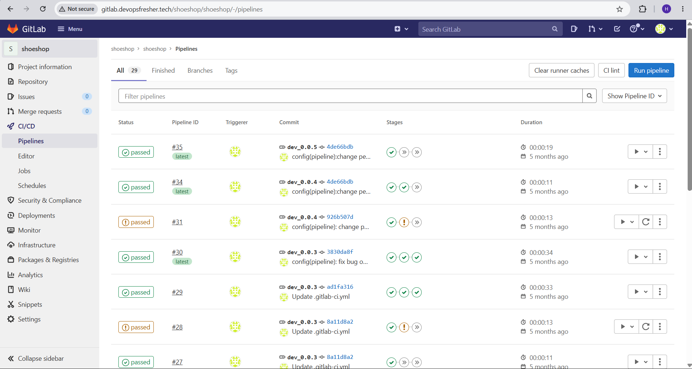
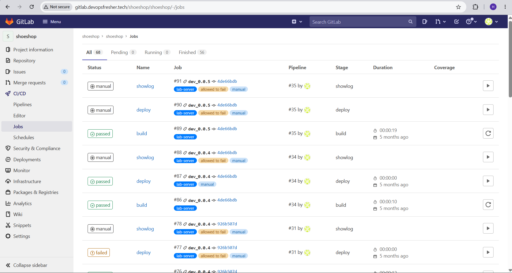
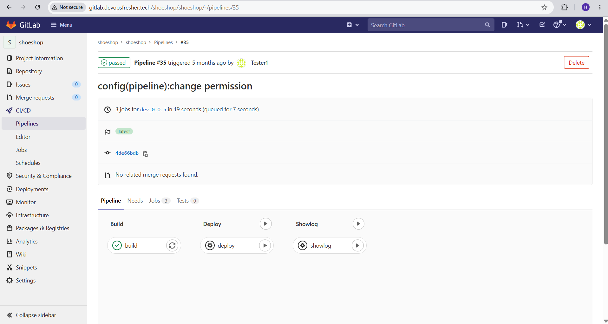
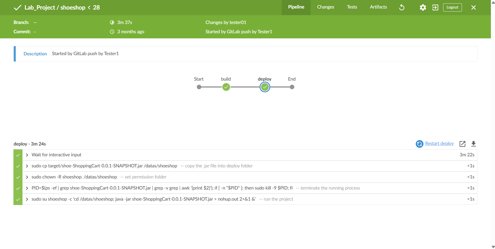
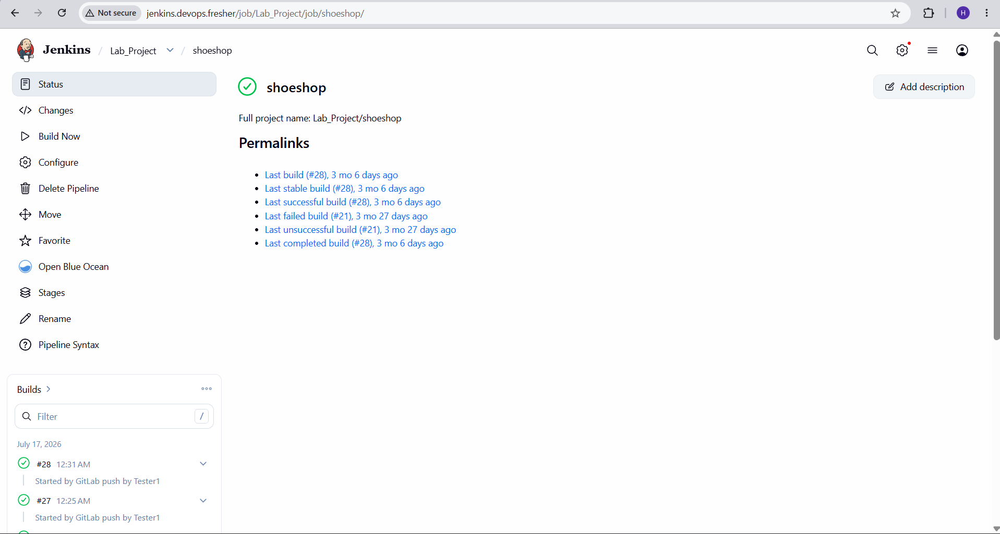

# Shoeshop onlines
Shoe Shopping Cart built with SpringBoot, JPA, MySQL , Spring Security, Hibernate and Thymeleaf

`ProductList Page`

`Cart Page`

## CI/CD Pipeline

Tested on self-hosted Jenkins and GitLab CI (lab environment, not public — screenshots below).

### GitLab CI

Stages: `build` → `deploy` (manual) → `showlog` (manual)

### Jenkins

Stages: `build` → `deploy` (manual approval)
