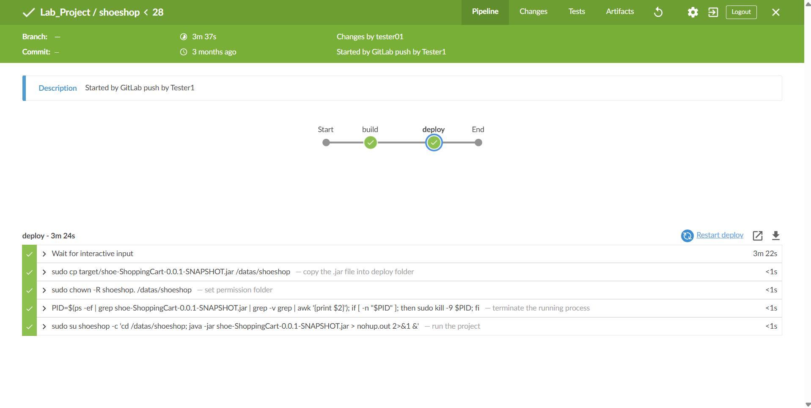

# Shoeshop: DevOps Practice Project

A Spring Boot online shoe shop (Java 8, Maven, MySQL), used to practice DevOps tools in a self-hosted lab.

| VM | Role |
|---|---|
| **GitLab Server** | Git repository and GitLab CI |
| **Jenkins Server** | Jenkins |
| **Zabbix Server** | Zabbix monitoring |
| **Ubuntu Server** (`lab-server`) | Runs the app, MySQL, the GitLab Runner, the Jenkins agent and the Zabbix agent |

---

## GitLab CI

Pipeline: `build` → `deploy` (manual) → `showlog` (manual). It runs when a Git tag is pushed. See [`.gitlab-ci.yml`](.gitlab-ci.yml).


## Jenkins

Pipeline: `build` → `deploy` (manual approval). See [`Jenkinsfile`](Jenkinsfile).




## Zabbix

Monitors `lab-server` with the Linux by Zabbix agent template.


## Docker

Build the image with the multi-stage [`Dockerfile`](Dockerfile):

```bash
docker build -t shoeshop:latest .
```

## Docker Compose

Start the app and MySQL together. The database is loaded from `shoe_shopdb.sql`.

```bash
docker compose up -d --build
```

Open <http://localhost:88>. To stop and delete the data:

```bash
docker compose down -v
```
