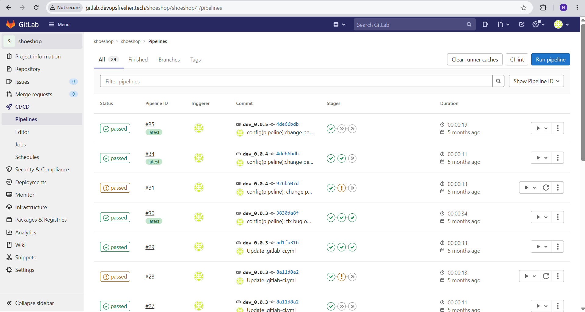

# Shoeshop Online

An online shoe store built with **Spring Boot 2.2, Hibernate, Spring Security, Thymeleaf and MySQL**. It is packaged with **Docker / Docker Compose** and deployed through **GitLab CI** and **Jenkins** pipelines.


---

## Table of contents

- [Features](#features)
- [Tech stack](#tech-stack)
- [Project structure](#project-structure)
- [Database](#database)
- [Running the app](#running-the-app)
  - [Option 1: Docker Compose (recommended)](#option-1-docker-compose-recommended)
  - [Option 2: Run with Maven](#option-2-run-with-maven)
- [Demo accounts](#demo-accounts)
- [Routes](#routes)
- [CI/CD pipelines](#cicd-pipelines)
  - [GitLab CI](#gitlab-ci)
  - [Jenkins](#jenkins)
- [Screenshots](#screenshots)
- [Known issues](#known-issues)

---

## Features

**Customers (no login needed)**
- Browse products with pagination (8 per page) and search by name
- Add products to a session-based cart, change quantities, remove items
- Enter customer details (name, email, phone, address) with validation
- Confirm and place the order, then see an order summary

**Staff (login needed)**
- `ROLE_EMPLOYEE` and `ROLE_MANAGER`: view account info, the order list (paginated) and order details
- `ROLE_MANAGER` only: create and edit products, including image upload (stored as a BLOB in MySQL)

## Tech stack

| Layer | Technology |
|---|---|
| Language | Java 8 |
| Framework | Spring Boot 2.2.5 (Web MVC, Security, Data JPA) |
| ORM | Hibernate 5 (a `SessionFactory` configured by hand) |
| View | Thymeleaf + `thymeleaf-extras-springsecurity5` |
| Database | MySQL 5.7 (the dump was made on MariaDB 10.1) |
| Build | Maven |
| Container | Docker (multi-stage build), Docker Compose |
| CI/CD | GitLab CI, Jenkins |

## Project structure

```
.
├── Dockerfile                 # Multi-stage build: maven:3.8.6-temurin-8 -> temurin:8-jre
├── docker-compose.yml         # MySQL 5.7 + app, seeds the DB from shoe_shopdb.sql
├── .gitlab-ci.yml             # GitLab pipeline: build -> deploy (manual) -> showlog (manual)
├── Jenkinsfile                # Jenkins pipeline: build -> deploy (manual approval)
├── shoe_shopdb.sql            # Schema + sample data (accounts, 11 products, 1 order)
├── pom.xml
├── docs/screenshots/          # CI/CD screenshots used in this README
└── src/main
    ├── java/com/example/demo
    │   ├── SpringShoppingCart2Application.java  # Entry point, DataSource/SessionFactory/TxManager beans
    │   ├── config/        # WebSecurityConfig (roles, login form), WebConfiguration (messages)
    │   ├── controller/    # MainController (shop + cart), AdminController (login, orders, products)
    │   ├── dao/           # AccountDAO, ProductDAO, OrderDAO (Hibernate queries)
    │   ├── entity/        # Account, Product, Order, OrderDetail
    │   ├── form/          # CustomerForm, ProductForm
    │   ├── model/         # CartInfo, CartLineInfo, CustomerInfo, OrderInfo, ...
    │   ├── pagination/    # PaginationResult
    │   ├── service/       # UserDetailsServiceImpl (loads users for Spring Security)
    │   ├── utils/         # Helpers for keeping the cart in the HTTP session
    │   └── validator/     # CustomerFormValidator, ProductFormValidator
    └── resources
        ├── application.properties   # DB connection + Hibernate settings
        ├── validation.properties    # Validation messages
        ├── static/                  # CSS and images
        └── templates/               # Thymeleaf pages
```

## Database

`shoe_shopdb.sql` creates 4 tables:

| Table | Purpose |
|---|---|
| `Accounts` | Staff accounts (BCrypt password, role, active flag) |
| `Products` | Code (PK), name, price, image (`LONGBLOB`), created date |
| `Orders` | Order header: customer info, amount, order number (unique) |
| `Order_details` | Order lines, with foreign keys to `Orders` and `Products` |

## Running the app

### Option 1: Docker Compose (recommended)

Requirements: Docker and Docker Compose.

```bash
docker compose up -d --build
```

- App: <http://localhost:88>
- MySQL: `localhost:3307` (user `shoeshop` / `1234`, database `shoeshop`)

On first start, MySQL runs `shoe_shopdb.sql` from `docker-entrypoint-initdb.d`. The app waits for the DB health check before it starts. Compose overrides the DB settings through the `SPRING_DATASOURCE_*` environment variables.

To stop it and remove the data volume:

```bash
docker compose down -v
```

### Option 2: Run with Maven

Requirements: JDK 8, Maven 3.6+, and a MySQL server.

1. Create the database and import the data:
   ```bash
   mysql -u root -p -e "CREATE DATABASE shoeshop; CREATE USER 'shoeshop'@'%' IDENTIFIED BY '1234'; GRANT ALL ON shoeshop.* TO 'shoeshop'@'%';"
   mysql -u root -p shoeshop < shoe_shopdb.sql
   ```
2. Point the app at your DB. Either edit `src/main/resources/application.properties` (it currently points to the lab server `192.168.139.100`), or override it at runtime:
   ```bash
   mvn clean package -DskipTests
   java -jar target/shoe-ShoppingCart-0.0.1-SNAPSHOT.jar \
     --spring.datasource.url=jdbc:mysql://localhost:3306/shoeshop?useSSL=false
   ```
3. Open <http://localhost:8080>.

## Demo accounts

Log in at `/admin/login`:

| Username | Password | Role |
|---|---|---|
| `employee1` | `123` | `ROLE_EMPLOYEE` |
| `manager1` | `123` | `ROLE_MANAGER` |

## Routes

| URL | Access | Description |
|---|---|---|
| `/` | Public | Home page |
| `/productList?name=&page=` | Public | Product list with search |
| `/buyProduct?code=` | Public | Add a product to the cart |
| `/shoppingCart` | Public | View or update the cart |
| `/shoppingCartCustomer` | Public | Enter customer details |
| `/shoppingCartConfirmation` | Public | Review and place the order |
| `/shoppingCartFinalize` | Public | Order placed |
| `/productImage?code=` | Public | Product image from the DB |
| `/admin/login`, `/admin/logout` | Public | Staff login and logout |
| `/admin/accountInfo` | Employee, Manager | Logged-in account info |
| `/admin/orderList`, `/admin/order?orderId=` | Employee, Manager | Orders and order details |
| `/admin/product?code=` | Manager | Create or edit a product |

## CI/CD pipelines

Both pipelines were tested on a self-hosted lab (a runner/agent labelled `lab-server`). They are not public, so screenshots are included below. Both deploy the same way: build the JAR, copy it to `/datas/shoeshop/`, give ownership to the `shoeshop` user, kill the old process, and start the new JAR in the background with its log in `nohup.out`.

### GitLab CI

File: [`.gitlab-ci.yml`](.gitlab-ci.yml). It runs only when a **tag** is pushed.

| Stage | Trigger | What it does |
|---|---|---|
| `build` | Automatic | `mvn install -DskipTests=True` |
| `deploy` | Manual | Copies the JAR, restarts the app. Only the user `tester01` is allowed; anyone else gets `Permission denied` |
| `showlog` | Manual | Waits 20 seconds, then prints the end of `nohup.out` |




### Jenkins

File: [`Jenkinsfile`](Jenkinsfile). It runs on an agent labelled `lab-server`.

| Stage | What it does |
|---|---|
| `build` | `mvn clean install -DskipTests=true` with a shared local Maven repository |
| `deploy` | Waits up to 5 minutes for someone to answer *"Can it be deployed?"* (yes/no). On **yes**: copy the JAR, set ownership, kill the old process only if a PID is found, start the new JAR |


## Screenshots

**Product list**


**Cart**


## Known issues

- **Table name case.** The `OrderDetail` entity maps to `Order_Details`, but the SQL dump creates `Order_details`. MySQL on Linux treats table names as case-sensitive by default, so order details may fail to load or save there. Fix it by renaming one of them, or by setting `lower_case_table_names=1` on the MySQL server.
- **Credentials in the repo.** The DB password (`1234`) is in `application.properties` and `docker-compose.yml`. That is fine for a lab, but use environment variables or secrets in a real deployment.
- **CSRF protection is turned off** in `WebSecurityConfig`.
- **No real tests.** There is only the default `contextLoads` test, and it needs a working DB connection. That is why the pipelines build with `-DskipTests`.
