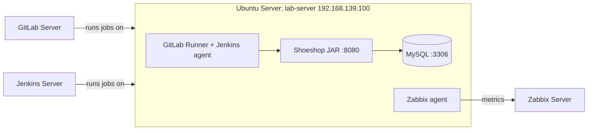
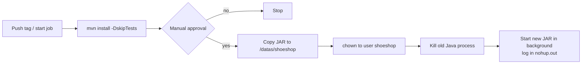
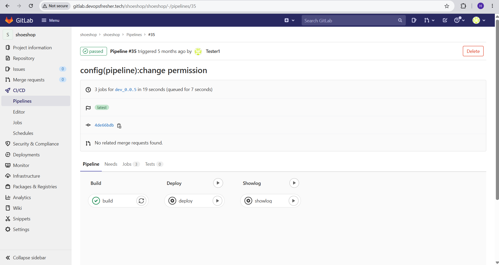

# Shoeshop: DevOps Practice Project

A practice project for **containerizing and deploying** a Spring Boot web app (an online shoe shop with Java 8, Maven and MySQL). The app code came with the project. The DevOps work in this repo is:

- **Docker**: a multi-stage `Dockerfile`
- **Docker Compose**: runs the app and MySQL together on one machine, with the database filled automatically
- **GitLab CI**: build, manual deploy and log check, triggered by Git tags
- **Jenkins**: declarative pipeline with a manual approval step before deploy
- **Zabbix**: monitors the server that runs the app

---

## Lab infrastructure

Everything runs on self-hosted virtual machines:

| VM | Role |
|---|---|
| **GitLab Server** | Hosts the Git repository and runs GitLab CI |
| **Jenkins Server** | Jenkins controller |
| **Zabbix Server** | Zabbix server and web UI (`zabbix.devops.fresher`) |
| **Ubuntu Server** (`lab-server`, `192.168.139.100`) | Runs the app, MySQL, the GitLab Runner and the Jenkins agent (both labelled `lab-server`), and the Zabbix agent |



---

## Repository layout (DevOps files)

```
.
├── Dockerfile           # Multi-stage build: Maven (JDK 8) -> JRE 8 runtime
├── .dockerignore        # Keeps target/, .git, SQL, CI files out of the build context
├── docker-compose.yml   # mysql:5.7 + app, health check, persistent volume
├── shoe_shopdb.sql      # Loaded into MySQL when the container first starts
├── .gitlab-ci.yml       # GitLab pipeline: build -> deploy (manual) -> showlog (manual)
├── Jenkinsfile          # Jenkins pipeline: build -> deploy (manual approval)
└── docs/screenshots/    # Screenshots of pipeline runs
```

---

## 1. Docker

[`Dockerfile`](Dockerfile) builds the image in two stages:

| Stage | Base image | What it does |
|---|---|---|
| `build` | `maven:3.8.6-eclipse-temurin-8` | Copies `pom.xml` and runs `mvn dependency:go-offline` first, so the dependency layer stays cached until the POM changes. Then copies `src/` and runs `mvn package -DskipTests` |
| runtime | `eclipse-temurin:8-jre` | Copies only the built JAR as `app.jar`, exposes port `8080` and runs `java -jar app.jar` |

The final image has only the JRE and the JAR. Maven and the source code stay in the build stage.

```bash
docker build -t shoeshop:latest .
```

## 2. Docker Compose

[`docker-compose.yml`](docker-compose.yml) runs the whole stack:

| Service | Image | Host port | Notes |
|---|---|---|---|
| `db` | `mysql:5.7` | `3307 -> 3306` | Runs `shoe_shopdb.sql` from `/docker-entrypoint-initdb.d` on first start. Data is kept in the `db-data` volume. Has a `mysqladmin ping` health check |
| `app` | built from `Dockerfile` | `88 -> 8080` | `depends_on: condition: service_healthy`, so the app waits until MySQL is ready. The DB connection is set with `SPRING_DATASOURCE_*` environment variables, which override `application.properties` |

```bash
docker compose up -d --build     # start
docker compose logs -f app       # follow the app logs
docker compose down -v           # stop and delete the DB volume
```

Then open <http://localhost:88>. You can log in at `/admin/login` as `manager1` with password `123`.

---

## 3. CI/CD on a self-hosted lab server

Both pipelines run on a self-hosted Linux server. It has the label `lab-server` both as a GitLab Runner and as a Jenkins agent. The servers are not public, so screenshots are included.

### How a deploy works

Both pipelines deploy the app the same way: as a plain process on the server, not in a container.



The app runs under its own Linux user, `shoeshop`. The CI user uses `sudo` to copy the JAR, set ownership and start the process as `shoeshop`.

### GitLab CI

File: [`.gitlab-ci.yml`](.gitlab-ci.yml). Every job uses `only: tags`, so the pipeline runs only when a tag is pushed:

```bash
git tag v1.0.0 && git push origin v1.0.0
```

| Stage | When | What it does |
|---|---|---|
| `build` | Automatic | `GIT_STRATEGY: clone`, then `mvn install -DskipTests=True` |
| `deploy` | Manual | `GIT_STRATEGY: none`, so it reuses the JAR built in the same directory. Only the GitLab user `tester01` may deploy; anyone else gets `Permission denied` and the job fails |
| `showlog` | Manual | Waits 20 seconds, then prints the end of `nohup.out` to check that the app started |

Pipeline variables: `projectname`, `version`, `projectuser=shoeshop`, `projectpath=/datas/shoeshop/`.




### Jenkins

File: [`Jenkinsfile`](Jenkinsfile). It is a declarative pipeline that runs on agent `lab-server`. All the shell commands are defined once in the `environment` block.

| Stage | What it does |
|---|---|
| `build` | `mvn clean install -DskipTests=true`, using a shared Maven cache at `/datadrive/jenkins_workspace/.m2/repository` |
| `deploy` | An `input` step asks *"Can it be deployed?"* (yes/no) and waits up to **5 minutes**. On **yes** it copies the JAR, runs `chown`, kills the old process and starts the new JAR |

Changes made to the original pipeline:
- The kill step now kills only when a PID is found (`if [ -n "$PID" ]`). Before, the stage failed on the first deploy, when no process was running yet.
- The run command uses double quotes outside and single quotes inside. This lets Groovy fill in `${appUser}` and `${folderDeploy}` while the shell still gets a valid command.


---

## 4. Monitoring with Zabbix

A self-hosted **Zabbix** server monitors the lab server that runs the app. The data comes from a Zabbix agent installed on the lab server.

| Item | Value |
|---|---|
| Monitored hosts | 2: the Zabbix server itself and `lab-server` (`192.168.139.100`) |
| Template | Linux by Zabbix agent (CPU, memory, disk, network, uptime, security checks) |
| Items / triggers | 210 items (202 enabled), 105 triggers |


Both alerts in the screenshot are expected:

- **`/etc/passwd has been changed`** (Information): the Linux user `shoeshop`, which runs the app, was created on the server. Zabbix's security check noticed that the user list changed.
- **`lab-server has been restarted (uptime < 10m)`** (Warning): the server was rebooted shortly before the screenshot was taken.

---

## Known limitations and next steps

- **Credentials are in plain text.** The DB password is in `application.properties` and `docker-compose.yml`. Next step: move it to a `.env` file, GitLab CI/CD variables or Jenkins credentials.
- **Tests are skipped** (`-DskipTests`). The only test needs a live database. Next step: add a test stage that runs with a MySQL service container.
- **Deploys use a bare JAR with `nohup`.** Nothing restarts the app if it crashes, and there is no rollback. Next step: run it as a `systemd` service, or deploy the Docker image from a registry.
- **Monitoring stops at the OS level.** Zabbix tracks the server, not the app. Next step: add a web scenario on port `8080` and a check that the Java process is running, so a failed deploy raises an alert.
- **No image registry.** The Docker image is only built locally. Next step: push it to the GitLab Container Registry or Docker Hub from CI.
- **Table name case.** The entity maps to `Order_Details`, but the SQL dump creates `Order_details`. MySQL on Linux (including the `mysql:5.7` container) treats table names as case-sensitive, so order details may fail. Fix it by renaming one of them, or by setting `lower_case_table_names=1` on MySQL.
