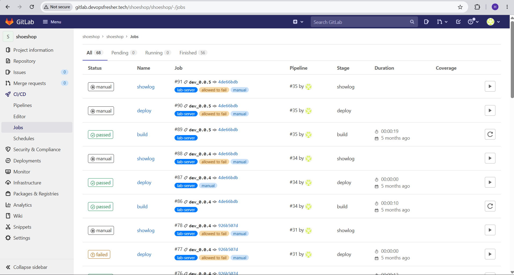
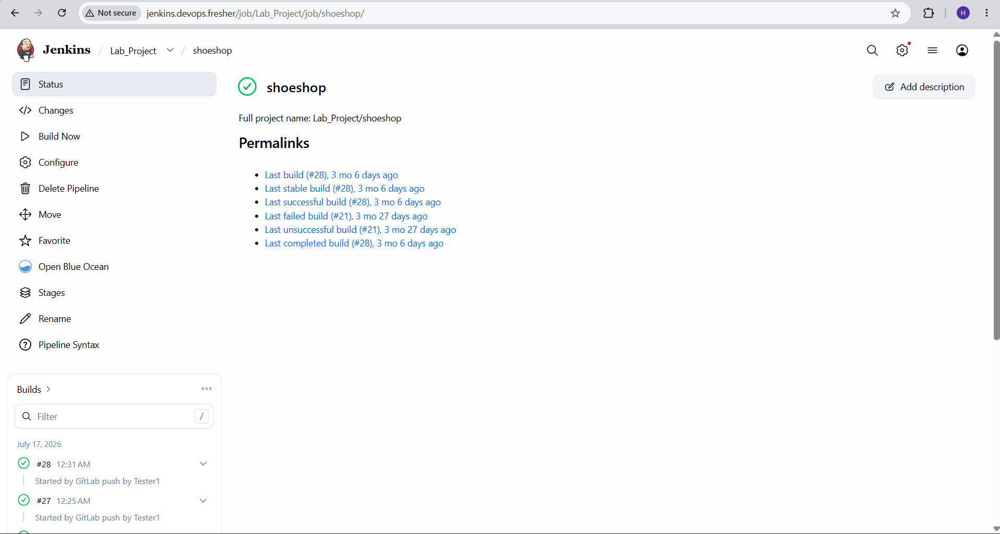
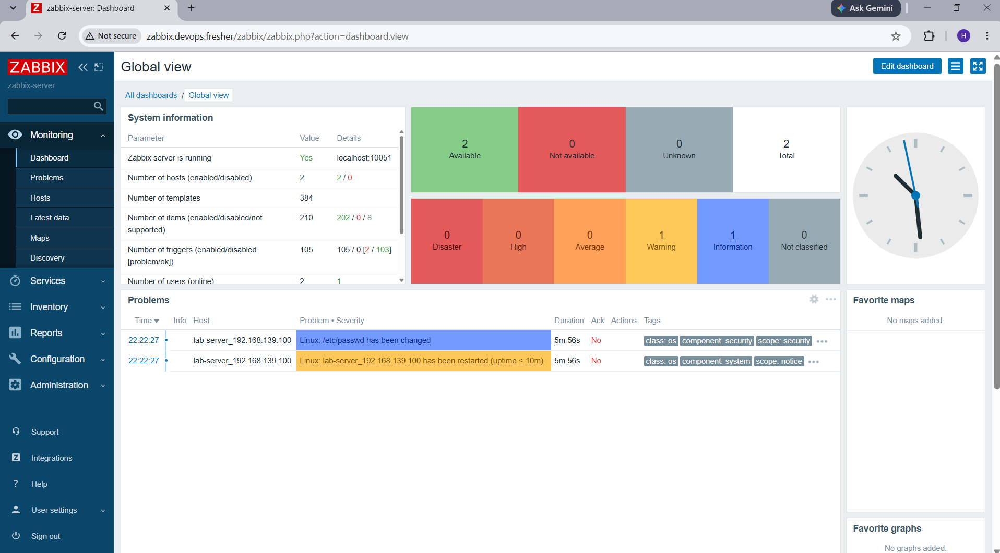

# Shoeshop: DevOps Practice Project

A Spring Boot online shoe shop (Java 8, Maven, MySQL), used to practice DevOps tools in a self-hosted lab.

| VM | Role |
|---|---|
| **GitLab Server** | Git repository and GitLab CI |
| **Jenkins Server** | Jenkins |
| **Zabbix Server** | Zabbix monitoring |
| **Ubuntu Server** (`lab-server`) | Runs the app, MySQL, the GitLab Runner, the Jenkins agent and the Zabbix agent |

---

## GitLab CI

File: [`.gitlab-ci.yml`](.gitlab-ci.yml)

**How it works**

1. **Trigger.** Every job has `only: tags`, so a normal push does nothing. A pipeline starts only when a tag is pushed:
   ```bash
   git tag v1.0.0 && git push origin v1.0.0
   ```
2. **Runner.** GitLab Server does not run the jobs itself. It sends them to the GitLab Runner registered on `lab-server` (every job has `tags: lab-server`). The runner runs the scripts as shell commands on that machine.
3. **Stages.** The stages run in order, and each one must pass before the next can start:

   | Stage | Start | What happens |
   |---|---|---|
   | `build` | Automatic | Clones the repo (`GIT_STRATEGY: clone`) and runs `mvn install` to build the JAR in `target/` |
   | `deploy` | Manual (click ▶) | Skips the clone (`GIT_STRATEGY: none`) and reuses the JAR from `build`. Checks who clicked: only the user `tester01` may deploy. Copies the JAR to `/datas/shoeshop/`, kills the old Java process and starts the new one in the background with `nohup` |
   | `showlog` | Manual | Waits 20 seconds, then prints `nohup.out` so you can check that the app started |





## Jenkins

File: [`Jenkinsfile`](Jenkinsfile)

**How it works**

1. **Trigger.** A Jenkins job reads the `Jenkinsfile` from the repo. A build is started from the Jenkins UI with *Build Now*.
2. **Agent.** `agent { label 'lab-server' }` tells the Jenkins Server to run the pipeline on the agent node `lab-server`, not on the Jenkins machine itself.
3. **Variables.** The `environment` block defines the app name, deploy folder and every shell command once. The stages only call these variables.
4. **Stages:**

   | Stage | What happens |
   |---|---|
   | `build` | `mvn clean install` builds the JAR. Maven dependencies are cached in a shared folder, so later builds are faster |
   | `deploy` | The pipeline pauses and asks **"Can it be deployed?"** with a yes/no choice. If nobody answers within **5 minutes**, it stops without deploying. On **yes**: copy the JAR to `/datas/shoeshop`, set the owner to user `shoeshop`, kill the old process (only if one is running), start the new JAR in the background |




## Zabbix

**How it works**

1. **Agent.** A Zabbix agent runs on `lab-server`. It collects data about the machine, such as CPU, memory, disk, network, uptime and changes to system files.
2. **Server.** The Zabbix Server gets this data from the agent (agent port `10050`) and stores it in its database.
3. **Template → items → triggers.** The host uses the *Linux by Zabbix agent* template:
   - an **item** is one value to collect, for example CPU load;
   - a **trigger** is a rule on an item, for example "uptime < 10 minutes".
4. **Problems.** When a trigger's rule is true, Zabbix creates a **problem** with a severity (Information, Warning, High, ...). Problems are shown on the dashboard until the rule is false again.

In the screenshot, Zabbix shows two problems on `lab-server`: `/etc/passwd` changed (a Linux user was added) and the server was restarted less than 10 minutes ago.



## Docker

File: [`Dockerfile`](Dockerfile)

**How it works:** a **multi-stage build**.

1. **Stage `build`** (`maven` image with JDK 8): copies `pom.xml` and downloads the dependencies first, then copies the source and builds the JAR. Docker caches each step, so if only the source changed, the dependency download is skipped on the next build.
2. **Final stage** (`eclipse-temurin:8-jre`): copies only the JAR from the first stage and runs `java -jar app.jar` on port `8080`. Maven and the source code are not in the final image, which keeps it small.

```bash
docker build -t shoeshop:latest .
docker run -p 8080:8080 shoeshop:latest   # needs a reachable MySQL
```

## Docker Compose

File: [`docker-compose.yml`](docker-compose.yml)

**How it works:** one command starts two containers on a shared network.

1. **`db`** (MySQL 5.7) starts first. On its first start it runs `shoe_shopdb.sql` to create the tables and sample data. The data is kept in the `db-data` volume, so it survives restarts.
2. A **health check** (`mysqladmin ping`) runs every 5 seconds. The **`app`** container waits until MySQL reports healthy (`depends_on: condition: service_healthy`).
3. **`app`** is built from the `Dockerfile`. It reaches MySQL by the service name `db`. The `SPRING_DATASOURCE_*` environment variables replace the DB settings in `application.properties`.
4. Ports: the app is on `localhost:88`, MySQL on `localhost:3307`.

```bash
docker compose up -d --build   # build and start
docker compose logs -f app     # follow the app logs
docker compose down -v         # stop and delete the data
```
